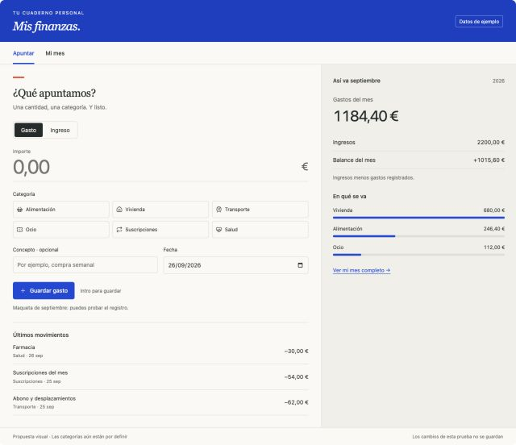

# Finario

Aplicación personal de escritorio para registrar gastos e ingresos por categoría, con almacenamiento local y una portada ilustrada de Madrid.

**Estado:** primera fase implementada: portada y registro de gastos e ingresos con persistencia SQLite local. Análisis aparece como «Próximamente» y está desactivado. Mi mes, gráficas y presupuestos quedan para fases posteriores.

## Requisitos

- macOS con Xcode Command Line Tools (`xcode-select --install`).
- Rust estable (instalado con [rustup](https://rustup.rs)).
- Node.js y pnpm.

## Comandos

```sh
pnpm install            # dependencias del frontend y CLI de Tauri
pnpm app:dev            # abre la aplicación en modo desarrollo (Tauri + Vite)
pnpm app:build          # genera src-tauri/target/release/bundle/macos/Finario.app
pnpm test:rust          # tests de validación, persistencia, copias e IPC
pnpm typecheck          # comprobación de tipos TypeScript
pnpm build              # typecheck + build del frontend en dist/
```

Para instalar la versión compilada en tu usuario: `ditto src-tauri/target/release/bundle/macos/Finario.app ~/Applications/Finario.app`. Los datos no se ven afectados porque viven fuera de la app.

Tipografías de Google Fonts, empaquetadas localmente con Fontsource: **Fraunces** en la portada y el logotipo, e **Instrument Sans** en el registro.

`pnpm dev` levanta solo el frontend en http://localhost:1420. Fuera de Tauri no hay base de datos, así que la interfaz no puede cargar ni guardar datos: úsalo solo para trabajar en estilos.

### Aviso sobre Command Line Tools

Si la compilación de Rust falla con `tapi error: ... unknown architecture arm64e.x1`, significa que el SDK por defecto de las Command Line Tools es más nuevo que su enlazador. Puedes actualizar las Command Line Tools o indicar un SDK compatible:

```sh
SDKROOT=/Library/Developer/CommandLineTools/SDKs/MacOSX26.5.sdk pnpm app:dev
```

## Datos

- Base de datos: `~/Library/Application Support/es.finario.escritorio/finario.sqlite3`. Se guarda fuera de la aplicación y del repositorio, y se conserva al actualizar.
- Copias: `~/Library/Application Support/es.finario.escritorio/copias/`. Cada día, al abrir la app, se crea una copia automática y se conservan las 14 últimas. Desde **Copias de seguridad** puedes crear una copia manual, exportarla a otra ubicación o restaurar una copia. Antes de restaurar, Finario valida el archivo y guarda una copia del estado actual.
- Los importes se guardan en céntimos enteros (EUR). Rust valida importe, categoría, fecha y concepto, y SQLite añade restricciones `CHECK`, claves foráneas y triggers como segunda barrera.
- La app empieza sin movimientos. El catálogo inicial de categorías es provisional y editable: renombrar, reordenar, archivar y recuperar sin perder el historial.

## Estructura

```
src/                    React + TypeScript
  screens/              Portada y Registro
  components/           Formulario, lista, avisos, diálogos
  lib/                  API de comandos Tauri, formato, iconos
  assets/               Paisaje de portada sin interfaz incrustada
src-tauri/src/          Rust
  db.rs                 Conexión, PRAGMAs y migraciones
  money.rs              Parseo exacto de importes a céntimos
  store.rs              Categorías y movimientos
  backup.rs             Copias, validación y restauración
  lib.rs                Comandos Tauri
  tests.rs              Tests de integración
scripts/prepare-portada.py   Genera src/assets/portada-madrid.jpg desde la referencia 01
```

`scripts/prepare-portada.py` requiere `opencv-python-headless` y `numpy`. No modifica la referencia original.

## Documentación de diseño

1. [AGENTS.md](AGENTS.md): instrucciones de trabajo y límites del alcance.
2. [DESIGN.md](DESIGN.md): decisiones visuales, navegación, comportamiento y criterios de aceptación.
3. [Arquitectura](docs/ARCHITECTURE.md): stack, datos y persistencia.
4. [Plan de implementación](docs/IMPLEMENTATION.md): fases y verificaciones.
5. [Guía de referencias](docs/references/README.md): qué conservar y qué modificar en las dos imágenes.

## Decisiones aprobadas

- Nombre: **Finario**.
- Portada: paisaje madrileño con textura analógica, metro Estrecho de tamaño discreto y cartel vintage de Mahou.
- Título Finario más grande que el antiguo nombre de la referencia.
- Debajo, exactamente: **Pecunia, si uti scis, ancilla est; si nescis, domina**
- Acción principal: **Gastos e ingresos**.
- Segunda acción: **Análisis · Próximamente**, desactivada.
- Interior limpio para registrar y gestionar movimientos. Mi mes y los análisis se harán después.
- Stack: **Tauri 2 + React + TypeScript + SQLite**, con la lógica local en Rust.
- Interfaz en español, funcionamiento offline, sin login. EUR como supuesto inicial pendiente de confirmación.

## Referencias visuales

### Portada aprobada (textos antiguos sustituidos en la app)


### Interior (análisis fuera de alcance)



La [maqueta navegable](docs/references/registro-maqueta.html) es una referencia histórica con datos ficticios; no es código de producción.
